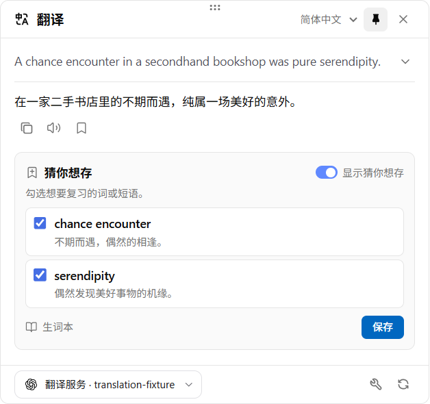

# TextHop

桌面划词与截图助手。选中文字后，通过快捷键或鼠标旁的划词工具栏翻译、查词或润色，结果在鼠标旁的浮窗中逐步显示。主窗口提供设置和本地笔记库。当前为 **0.10.0 开发预览**。

[浮窗与设置预览](docs/context-preview.html) · [设计依据](docs/DESIGN.md) · [验证状态](docs/VERIFICATION.md)



## 本机使用

Windows [便携版](<release/TextHop 0.10.0.exe>) · [安装包](<release/TextHop Setup 0.10.0.exe>)。包含中英文离线 OCR，无需 Node.js。构建未签名，安装与卸载流程尚未验收。

首次手动启动进入设置。右键点击系统托盘里的 TextHop 图标，勾选「开机自启」即可在登录时直接进入托盘，再点一次即可关闭。新安装默认关闭，此设备偏好独立于 WebDAV 和配置导入。

在 **设置 → API 提供商** 添加 OpenAI、DeepSeek、阿里云百炼、硅基流动、Gemini、OpenRouter 或自定义兼容接口。每个提供商选择一个模型。输入名称即可搜索内置候选，也可以获取服务返回的列表或填写自定义 ID。需要同一账号的另一个模型时，点击表单底部的 **复制**，再修改副本。在 **功能提供商** 为各个动作分配提供商。在模型下方可设置推理强度，默认由提供商决定。高级选项可设置温度、自定义请求头、流式输出和超时。

在 **设置 → 文本转语音** 可按语言选择音色，设置兜底声音，试听并调节语速、音高和音量。默认使用本机系统声音。要使用在线音色，在 **API 提供商** 添加支持 `/audio/speech` 的语音模型，然后在朗读设置中选择该提供商和音色。划词工具栏、译文、词典例句和笔记卡片共用此设置。

**截图识别** 默认在本机使用随包内置的中英文 OCR，也可选择已配置的视觉提供商。**通用 → 界面语言** 默认为跟随系统，可切换简体中文或 English。翻译目标语言、释义语言和界面语言分别保存。配置与凭据自动保存，WebDAV 和配置迁移统一位于 **配置管理**。

在 **自定义 AI 指令 → 划词工具 → 翻译** 可配置翻译提供商和目标语言，浮窗里的更改也会沿用到下次划词。在 **自定义 AI 指令** 中点「添加指令」可从词典、长难句分析、写作改进或空白模板开始。点内置指令的「定制化」可创建独立副本。每条新指令可配置提示词、输出 Schema、HTML + Liquid 版式和本地笔记字段映射。版式预览支持示例数据、宽度、明暗主题和流式重放。图标选择器提供 11,534 个离线图标。

在 **自定义 AI 指令 → 笔记库** 选择已有库，将输出字段映射到相同类型的列。首次点结果书签也可直接「创建并保存」。此后，书签和「猜你想存」按所选指令的连接保存。本地笔记库支持搜索、筛选和回看结果。[交互对照](docs/READ-FROG-PARITY.md)

**猜你想存** 在翻译完成后推荐原文中最多两个词或短语。勾选后点击「保存」，每个词条会带着释义和当时选中的原文写入对应的本地笔记本。默认使用词典指令，继承默认文字提供商。可在「通用 → 猜你想存」更改指令、提供商或关闭推荐，也可在翻译卡片上直接关闭。

**通用 → AI 结果缓存** 默认复用最近 30 分钟的相同请求，可选 5 分钟、30 分钟、1 小时、6 小时或 24 小时，也可关闭或直接清空。升级前设置的其他时长可继续使用。重新生成会请求新的结果。缓存只在进程内存中保留。

## 交互

- 划词工具栏的“更多”在原选区旁展开。拖动调整顺序，点击图钉固定动作。右上角关闭菜单可暂停一小时、在当前应用禁用或全局禁用。进入通用设置可恢复。

- 选中文字后按 `Alt + T` 直接翻译、`Alt + Shift + D` 查词、`Alt + Shift + W` 润色；`Ctrl/⌘ + Shift + Space` 打开动作菜单。这是新配置的默认值；升级保留原来的翻译快捷键。设置 → 快捷键可按键录入，自动保存、校验冲突、清空停用；自定义动作也可绑定。
- 动作快捷键在按下时重新读取当前选区，支持键盘选字；未读到选区不会处理旧文字或自动截图。OCR / 剪贴板浮窗获得焦点时，快捷键使用浮窗中当前校对后的文字。
- 对照 Read Frog 1.54.1 的划词工具栏、500 px 默认浮窗、原文折叠、动作标题、目标语言、固定/关闭、服务选择与重新生成。
- 翻译为直接可读的文本；词典包含读音、词性、释义、例句及级别；润色包含原文标注、修改说明和改后文本。自定义动作支持结构化结果与 Markdown。
- 设置、工具条和结果窗统一支持浅色、深色和跟随系统，切换即时生效。
- 普通浮窗失焦收起；固定后保留位置和大小。取消、重新划词或关闭结果窗会隔离旧请求。
- 截图或导入图片后，在浮窗内运行离线 OCR、核对原图并编辑文字。可选的视觉 OCR 复用服务商配置和密钥，通过 OpenAI 兼容图片接口请求；不提供 Ollama 专用适配器。
- 不能划选时按 `Ctrl/⌘ + Shift + 2` 或使用托盘“框选屏幕文字（OCR）”；本地识别自动开始，校对后复用同一动作浮窗。未读到选区只提供入口，不自动截屏。远程 OCR 先预览，点击识别才发送图片。
- 动作增删改、复制、启停、排序、固定和提示词预览；配置导入/导出、备份恢复及可选 WebDAV 手动同步。

原生选区、截图与原位替换的支持范围和实测状态见 [平台矩阵](docs/PLATFORMS.md)。Windows UIA 助手握手通过；当前测试环境无法激活专用编辑器，真实前台划词流程尚未完成验收。macOS、X11 和 Wayland 也仍需目标机验证。

## 开发与验证

需要 Node.js 24、npm 和平台构建工具。Windows 使用系统 .NET Framework 4.x 编译器；macOS 需要 `swiftc`。

```sh
npm ci
npm run assets:ocr
npm run build
npm start
```

`npm run dev` 会重新构建并运行。使用隔离配置并显示设置：

```sh
npm start -- --data-dir=./.local/profile-a --settings
```

如果安装策略阻止 Electron 的安装脚本，确认锁定依赖后可运行 `node node_modules/electron/install.js`。

```sh
npm run typecheck
npm test
npm run test:desktop
npm run test:suggestions
npm run test:input
npm run test:shortcuts
npm run test:settings
npm run test:toolbar
npm run test:upgrade
npm run test:ocr
npm run test:native
npm run dist
npm run test:packaged
```

- `test`：配置、并发草稿、窗口定位、HTTP 模型协议及 WebDAV 数据完整性。
- `test:desktop`：隔离配置的真实 Electron 窗口、自动保存、主题、选区事件 fixture、HTTP 模型 fixture 和真实 Tesseract OCR；生成 `docs/screenshots/v0.6/`。
- `test:input`：无选区引导、截图取消/恢复、自动本地 OCR、校对后动作衔接、远程发送边界、取消与空结果，以及真实截图/裁剪像素比对；报告分别标明前台内容验收限制。
- `test:shortcuts`：真实系统注册、按键录入与自动保存、冲突、清空/停用、自定义动作、OCR 校对文本、重复触发与迟到选区；OS 回调和选区值通过开发 fixture 驱动，实际外部前台选区与物理按键仍需交互验收。
- `test:settings` 检查提供商的复制、模型搜索与用途、温度、自定义请求头、OCR 选择、自动保存及界面语言。
- `test:startup` 验证登录启动的窗口可见性和原生托盘菜单，测试用模拟系统登记。
- `test:toolbar` 检查划词工具栏的展开、原选区、固定排序、三个暂停范围及恢复。
- `test:upgrade`：真实 Electron 重启、schema v2→v3、相同 ID 的文字/视觉服务分配、OS 加密凭据迁移和原文件备份。
- `test:ocr`：在主线程和 Worker 禁止网络的条件下验证已提交的样例图。
- `test:native`：真实 Windows 编辑器、前台选区、替换和区域截图。需要可交互桌面；无法激活目标窗口时失败，不能视为通过。
- `test:packaged`：启动当前 `release/win-unpacked/TextHop.exe`，检查版本、隔离开发测试入口、随包图标和真实中英文 OCR。
- `dist`：构建当前平台发行包；其他平台需要在对应系统构建。

正在运行另一份 TextHop 时，可用 `node scripts/shortcut-smoke.mjs --isolated-shortcuts` 与 `node scripts/packaged-smoke.mjs --isolated-shortcuts` 在测试配置中改用另一组快捷键，避免占用冲突。

## 文档

- [架构](docs/ARCHITECTURE.md)
- [模型目录与用途分配](docs/MODELS.md)
- [OCR 与模型](docs/OCR.md)
- [自动保存、迁移与 WebDAV](docs/CONFIGURATION.md)
- [平台验证](docs/PLATFORMS.md)
- [设计与 Read Frog 对照](docs/DESIGN.md)
- [验证报告](docs/VERIFICATION.md)

Read Frog 参考版本为 1.54.1，提交 `15c0cc56cfeb476c527cd57abfbfe8f03f2d6110`。TextHop 是独立桌面实现，采用相同公开图标集并保留许可，不打包其浏览器注入代码、品牌标志或私有布局引擎。项目许可为 GPL-3.0-only；详见 [第三方声明](THIRD_PARTY_NOTICES.md)。
