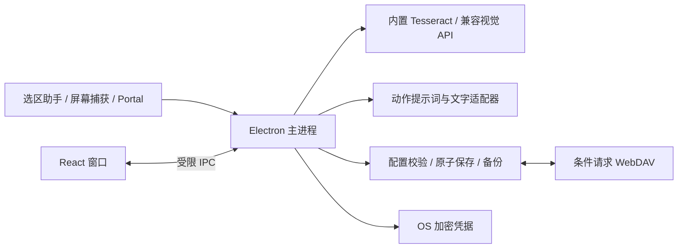

# 架构与范围

## 选型

Electron 45 + TypeScript + React。Electron 提供跨平台窗口、非激活浮标、全局快捷键、屏幕源、剪贴板、系统加密和桌面分发。Windows 使用独立 .NET Framework 辅助进程读取 UI Automation，避免被某个应用阻塞时冻结主进程。macOS 使用 Swift/AX；Linux 分开处理 X11 与 Wayland。

Windows 选区读取保留标准 Edit 控件的原位替换校验。其余界面从焦点控件、鼠标命中控件及其上层文档寻找 TextPattern；嵌入网页可能由其他进程提供，因此通过原生窗口的父子关系限定前台窗口，不要求提供者与窗口进程 ID 相同。鼠标移向工具栏时可以重新查询上次成功的文档，但不复用旧文字。取消选区、密码框、窗口切换和过长结果都不会留下可用选区。仅插入光标不视为选中文本。`npm run test:selection` 使用独立 Electron 桌面样例验证实际 UIA 读取和工具栏，`-- --packaged` 验证安装包产物；未提供 UIA 文本选区的应用仍需剪贴板或 OCR。

Tesseract.js 的 WASM 与语言包提供统一离线 OCR。选择它基于当前机器上的混合文字、深色和小字号样例，以及与 Windows OCR 的实测比较；并不意味着它对所有文档或系统最优。

## 边界

| 目录                | 责任                                                         |
| ------------------- | ------------------------------------------------------------ |
| `src/shared`        | 严格配置 schema、迁移、默认动作、纯文本整理、类型化 IPC 契约 |
| `src/core`          | 持久化、OCR、HTTP 模型适配、请求生命周期、WebDAV 冲突策略    |
| `src/main`          | 原生能力编排、凭据、窗口和 IPC 边界                          |
| `src/renderer`      | 设置窗口、选区图标工具条、动作浮窗、框选遮罩               |
| `native`            | Windows UIA、macOS AX、Wayland Screenshot portal             |
| `scripts` / `tests` | 构建、隔离配置测试、离线证明、可复现样例                     |

渲染进程无 Node，开启 context isolation 和 sandbox，CSP 禁止网络访问、脚本注入与表单提交。所有模型和同步网络请求仅在主进程。Markdown 不渲染 HTML、外部图片或可执行链接。自定义动作是保存的 AI 指令，不是 shell 命令。

文字与视觉共用服务商，凭据按服务商 ID 和服务端点绑定。导入同 ID 但不同端点的配置时，旧凭据不会发送到新端点；WebDAV 凭据也按 URL 和用户名绑定。Linux 缺少安全密钥环时，新凭据仅在内存保留。

每个运行任务使用独立 ID + AbortController，结果仅发送到创建任务的窗口。用户编辑原文、取消或开始新任务后，旧结果不再更新当前 UI。选区 token 与 AI 任务独立；替换按钮点击时仍需原生助手重新核验目标。

schema v4 使用统一的 `providers` 列表与每账户的 `models` 库，OCR 默认使用固定的离线引擎，也可直接选择服务商和图片模型。预设提供地址和经过官方目录核查的模型候选；不将未知模型标为已具备图片能力。`ModelPicker` 共用于模型库、动作、OCR 和浮窗；用途分配写入独立动作绑定，临时浮窗选择保持为会话状态。`/models`、文字与 `image_url` 图片请求共用 OpenAI 兼容适配器；原生 Ollama 路径已移除。旧 schema 迁移保留 ID 映射，主进程按原端点复制加密凭据。离线资源在构建时校验 SHA-256，运行时没有语言包下载/导入 IPC。

## 窗口与配置状态

主窗口仅配置用途，首次启动显示，之后默认驻留托盘；`--settings` 显式显示设置。设置窗口关闭时隐藏，自动保存仍可完成。工具条为不可激活的小窗口；动作在独立 500 DIP 浮窗运行。未固定浮窗失焦后取消任务并收起，固定后跨选区保留位置和尺寸。截图结果与剪贴板也进入浮窗，不创建工作台。

浮窗位置使用 Electron 鼠标和工作区 DIP，内容自适应高度不反复换算窗口宽度。会话 ID 与初始状态查询解决新窗口监听器尚未准备时的事件丢失。退出前停止原生监听，并销毁非激活工具条，避免销毁过程中焦点回调阻止退出。

设置以短时防抖、串行保存和 revision 校验写入。`rebaseDraft` 将保存回执和外部配置变更合并进未修改字段，保留用户仍在编辑的值。主题由主进程保存并广播，系统模式订阅 nativeTheme。凭据保持独立加密存储。

开发环境只有显式设置 `READFINCH_TEST_HOOKS=1` 才能向主进程注入测试选区；打包应用禁止此入口，不暴露为 renderer IPC。

0.2.2 将每个动作的快捷键纳入 schema v2，与菜单/OCR/剪贴板入口一起校验；注册表只变更发生修改的组合键。录入控件通过带所有者 ID 的 IPC 暂停/恢复全局快捷键，过期控件的清理不会解除另一个控件的录入状态；主窗口失焦、隐藏或 renderer 退出时也解除暂停。

动作快捷键分为外部选区与已有浮窗两条路径。外部路径通过原生 helper 的 `refresh` 请求 ID 获取新快照，超时或空选区不使用缓存；生成序号防止迟到快照覆盖后一个动作。Windows 显式请求允许 Shift 仍按住，且查询后再次核对前台窗口。已有浮窗路径发送动作事件，renderer 用最新编辑文本运行，复用请求取消/结果隔离。普通设置中忽略动作快捷键，OCR 正在识别时不运行文字动作。

0.2.1 将 `selection-unavailable`、`capture` 与 `image` 建模为不同输入来源。只有主动获取的图片会触发本地 OCR，且每个会话最多自动启动一次；普通选区事件、设置更新、恢复被取消的窗口不会启动 OCR。远程识别保留显式发送按钮。图片导入通过主进程创建新会话，清除旧选区 token，避免错误复用原位替换权限。

框选期间屏蔽划词浮标；完成裁剪后只将裁剪图片交给识别器。Esc/右键及门户取消分别清理框选会话、恢复旧窗口与固定状态；取消不产生新的取词会话。图片转文字之后，文字动作只接收校对后的文本，图片作为本地来源核对保留。

## 范围对照

保留/适配：选区工具栏、原文对照、流式结果、词典、写作、动作提示词、模型配置、主题、配置可迁移性。

新增桌面能力：原生选区、系统剪贴板、区域截图、离线与模型 OCR、OS 凭据存储、WebDAV 冲突保护、桌面快捷键。

不包含：字幕翻译、浏览器 DOM 注入、全网页翻译、站点规则、浏览器扩展打包、Google 账号/Drive 同步。

延期：闪卡/间隔复习、完整 PDF/EPUB 文档翻译、笔记平台集成、云账号、订阅和通用 shell 自动化。可见文字的一次性 OCR 仍支持。

本版不保存翻译历史或截图到磁盘。测试样例和验收截图是单独的非用户内容工件。窗口位置没有进入可迁移配置；当前不跨重启恢复窗口几何位置。
