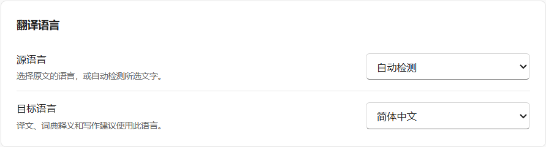

# Language preferences

In **General → Translation languages**, choose the source and target for your selections.

- **Source language** starts on **Auto-detect**. Choose a language when the same word can mean different things in different languages, or when you already know what you are reading. A fixed source bypasses language detection for translation. Detection of a selection never changes your preferences.
- **Target language** is the language for translations, dictionary definitions, grammar notes, writing feedback and suggested vocabulary notes. Writing revisions keep the original language. On first use, ReadFinch saves the first supported language in your operating system’s preference list, or English if none match. It stays selected until you change it, including from the translation window.
- **Interface language**, under **Appearance**, defaults to **Follow system**. On Windows it follows the current user's Windows display language. If the interface is unavailable in that language, ReadFinch uses the first supported language in the preference list, then English. Menus, built-in prompt wording and field labels support English and Simplified Chinese.

The eight preset translation languages are English, Simplified Chinese, Traditional Chinese, Japanese, Korean, French, German and Spanish. **Auto-detect** is available only for the source. Its detection method is configured under **API providers → Language detection**.

## Custom commands and saved results

Use `{{sourceLanguage}}` for the input language and `{{targetLanguage}}` for the language of the answer. Existing custom commands using `{{explanationLanguage}}` still work: the token is an alias for the target language. Edited prompts, layouts, samples and saved notes are preserved. A result already streaming keeps its original schema and language; regenerating uses the current settings.

An upgrade from a version with **Follow app language** saves its last effective target as a concrete language. Explicit source and target choices are kept. Exports and WebDAV carry those selections to another device without detecting them again.
