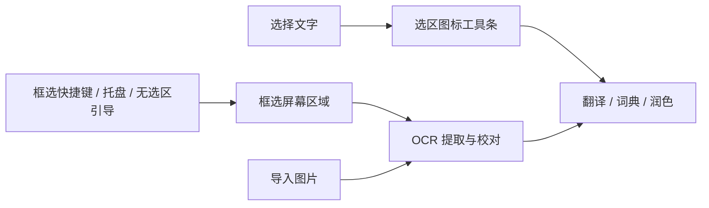

# OCR 与模型配置

## 划词与 OCR 的入口

OCR 是无法直接选择文字时的取词入口。两条路径取得文字后使用相同的翻译、词典、润色和自定义动作浮窗。

| 场景 | 触发方式 | 接下来 |
| --- | --- | --- |
| 网页、编辑器等提供真实文字选区 | 选择文字后出现图标工具条，或选区快捷键 | 点击动作，直接处理选中文字 |
| 图片、扫描 PDF、视频、远程桌面等不能划选的文字 | 默认 `Ctrl/⌘ + Shift + 2`，或托盘“框选屏幕文字（OCR）” | 框选区域，本地识别，校对后选择动作 |
| 主动调用选区功能，但应用没有提供可读选区 | 展示“未读到选中文字”，提供框选、剪贴板和图片导入 | 由用户选择取词方式，不自行截图 |
| 已有图片文件 | 在取词浮窗中导入图片 | 本地识别，复用同一校对与动作流程 |



“没有读到选区”不等于用户要求截图；没有选区事件时，应用也无法区分用户在划选图片、拖动窗口或进行其他操作。因此普通鼠标拖动不触发 OCR，也没有定时截屏或自动扫描全屏。框选时才临时捕获当前屏幕，识别服务只接收用户圈出的区域。

默认内置离线引擎在框选完成后自动开始识别，每次图片获取只启动一次。远程视觉服务先展示图片及发送目标，点击“识别文字”后才发送；不会因为 OCR 失败而换服务。OCR 不自动翻译，也不需要先配置文字模型。

识别结果保留原图，可校对、合并断行或复制。点击文字动作后折叠图片并进入相同结果卡片；“核对原图”和“校对文字”可返回来源。文字动作仅收到校对后的文字。截图没有原生编辑选区，不提供“替换原文”。

识别期间暂不可运行文字动作；取消、新图或新选区隔离旧请求。无文字时提示缩小范围或放大原画面再框选。Esc/右键取消框选不会开始 OCR，并恢复先前浮窗的内容和固定状态。暂停自动划词不影响手动框选。

## 离线引擎

默认后端为 Tesseract.js 7 / WASM LSTM，中英文识别资源（`eng+chi_sim`）和引擎都随应用内置。安装后第一次启动就能离线识别，不提供语言包下载、目录选择或本地导入设置。

语言数据来自 `tesseract-ocr/tessdata_fast` 的 `4.1.0` 标签，约 6.6 MB。开发者构建时用 `npm run assets:ocr` 准备资源；每次生产构建验证 `assets/ocr/manifest.json` 固定 SHA-256，缺少或损坏时构建失败。资源不进入配置导出或 WebDAV。

识别创建独立 Worker，只从随包路径加载 WASM 和识别资源，没有 CDN 回退。若安装文件损坏，界面提示重新安装；离线识别失败不会自动发送图片到外部服务。

本机样例结果：普通中英文和深色截图的 5 个关键词/路径/代码校验项全部匹配；13 px 小字样例匹配 3/4。Tesseract 报告的置信度是引擎信息，不是准确率保证。样例上的冷启动约 0.4–0.6 秒，识别约 0.3–0.8 秒，测试进程 RSS 约 185–192 MB。运行时对较小截图做有限 2× 放大。数值只代表当前 Windows 机器与这些样例。

Windows WinRT OCR 实测可用 `en-US`、`zh-Hans-CN`。最新记录中首个混合样例约 163 ms，但合并了行并在中文、路径和代码标点中加入空格/替换字符。Tesseract 更适合本版强调的文字、路径和代码提取，同时可复用于 macOS/Linux。因此选择统一引擎；小字、复杂排版、竖排、手写和低清晰度仍需人工核对。

原始结果见 [offline-ocr-verification.json](offline-ocr-verification.json)、[ocr-smoke.json](ocr-smoke.json) 和 [windows-ocr-comparison.json](windows-ocr-comparison.json)。

## 离线复现

从源码测试时先安装依赖、准备构建资源，然后运行：

```sh
npm run test:ocr
```

`scripts/block-network.cjs` 在主线程和 Tesseract 工作线程中替换 fetch、HTTP、HTTPS、TCP、TLS 入口，使任何联网尝试直接失败。报告会记录主线程与 Worker 均加载了禁网钩子。该测试不依赖 API Key，也不修改系统防火墙。可额外断开网络后在应用里导入样例图复核。

## 可选的服务商 OCR

1. 到“设置 → API 提供商”添加预设服务商或自定义 OpenAI 兼容接口，填写基础地址与 API Key。
2. 在提供商表单中选择支持图片输入的模型。然后到截图识别页选择该提供商，或在提供商表单的功能开关中开启 OCR。
3. 到“截图识别”核对所选提供商，点击“用样例图片测试”。实际发送一张包含 `TextHop OCR 123` 和中文的 PNG，核对返回文字。切换服务或模型后清除之前的测试结果。
4. 日常截图先展示原图与发送目标，点击识别后才发送。内置离线引擎始终可选；删除正在使用的 OCR 模型会恢复默认离线识别。

OCR 没有统一专用模型协议。本版选择 OpenAI 兼容 Chat Completions 的图片输入：`messages[].content` 包含文字指令与 `image_url` data URL。仅支持这种接口的视觉模型；专用文档识别 API、只支持文字的模型不在此适配范围。OpenAI 的[图片输入文档](https://developers.openai.com/api/docs/guides/images-vision)说明了这一格式；[阿里云百炼](https://help.aliyun.com/zh/model-studio/qwen-api-via-openai-chat-completions)、[硅基流动](https://docs.siliconflow.cn/docs/api/chat-completions-post)和 [Gemini 的兼容接口](https://ai.google.dev/gemini-api/docs/openai)也提供相应图片请求格式。具体模型仍须实际测试。

不提供 Ollama 原生适配、模型安装或下载管理。自定义服务只需遵循支持的 OpenAI 兼容接口；不要求服务运行在云端或本机，但外部引擎均保留显式发送图片步骤。

默认指令只提取原文，不翻译、不润色、不修正。返回文本可编辑；模型没有提供置信度时不显示分数。本机 HTTP fixture 已验证 PNG 图片、模型和共用密钥；当前没有用户外部服务凭据，真实服务识别质量尚未验收。

## API 提供商

「截图识别」可以在内置离线 OCR 和已配置的视觉提供商之间切换。先在「API 提供商」选好模型，再在截图识别页选提供商。远程提供商使用自己的模型、凭据、温度和请求头，识别指令可按提供商编辑。详见 [API 提供商与功能分配](MODELS.md)。
