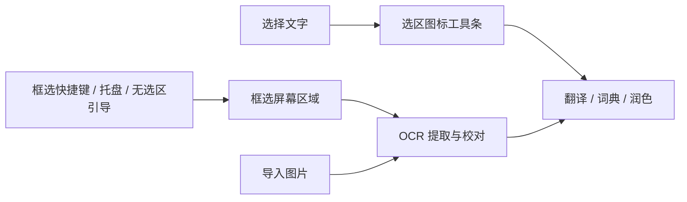

# 截图与图片识别（OCR）

伴读雀提供两种 OCR 方式：默认使用内置离线引擎，在本机识别简体中文和英文；也可以选择已配置的视觉提供商在线识别，支持的语言和识别效果由所选模型决定。

| 方式 | 图片处理位置 | 使用条件 |
| --- | --- | --- |
| 内置离线 OCR（默认） | 当前设备 | 安装后即可使用，无需 API 账户、联网或下载语言包 |
| 在线视觉提供商 | 所选提供商的服务端 | 在「API 提供商」配置支持图片输入的模型，再在「截图识别」选择该提供商 |

## 划词与 OCR 的入口

OCR 是无法直接选择文字时的取词入口。两条路径取得文字后使用相同的翻译、词典、润色和自定义指令浮窗。

| 场景 | 触发方式 | 接下来 |
| --- | --- | --- |
| 网页、编辑器等提供真实文字选区 | 选择文字后出现图标工具条，或选区快捷键 | 点击指令，直接处理选中文字 |
| 图片、扫描 PDF、视频、远程桌面等不能划选的文字 | 默认 `Ctrl/⌘ + Shift + 2`，或托盘“框选屏幕文字（OCR）” | 框选区域，使用所选 OCR 方式识别，校对后选择指令 |
| 主动调用选区功能，但应用没有提供可读选区 | 展示“未读到选中文字”，提供框选、剪贴板和图片导入 | 由用户选择取词方式，不自行截图 |
| 已有图片文件 | 在取词浮窗中导入图片 | 使用所选 OCR 方式识别，复用同一校对与指令流程 |



“没有读到选区”不等于用户要求截图；没有选区事件时，应用也无法区分用户在划选图片、拖动窗口或进行其他操作。因此普通鼠标拖动不触发 OCR，也没有定时截屏或自动扫描全屏。框选时才临时捕获当前屏幕，识别服务只接收用户圈出的区域。

默认内置离线引擎在框选完成后自动开始识别，每次图片获取只启动一次。在线识别需先配置并选择视觉提供商；不会因为离线 OCR 失败而自动切换到在线服务。OCR 提取原文，不自动翻译；离线识别不需要先配置 AI 提供商。

在识别浮窗中切换提供商会立即用当前原图重新识别，无需再点击「识别文字」。选择在线提供商时，图片会发送给该服务。正在进行的旧请求会取消，迟到结果不会覆盖新结果。

识别结果保留原图，可校对、合并断行或复制。点击文字指令后折叠图片并进入相同结果卡片；“核对原图”和“校对文字”可返回来源。文字指令仅收到校对后的文字。截图没有原生编辑选区，不提供“替换原文”。

识别期间暂不可运行文字指令；取消、新图或新选区隔离旧请求。无文字时提示缩小范围或放大原画面再框选。Esc/右键取消框选不会开始 OCR，并恢复先前浮窗的内容和固定状态。暂停自动划词不影响手动框选。

## 框选画面

框选窗口覆盖完整显示器，包含任务栏所在区域；屏幕快照按原始设备像素显示。选区通过遮罩留空露出同一张原图，不重复缩放或绘制选区背景。图片解码完成后才显示窗口，拖动时隐藏操作提示，尺寸标注使用实际截图像素。Esc 或右键取消，单击后可以重新开始拖选。

Windows 的无边框窗口默认仍可能带有原生框架，并受工作区尺寸限制；ReadFinch 为截图窗口关闭这些边框，并使用全屏边界。[Electron 窗口选项](https://www.electronjs.org/docs/latest/api/base-window#new-basewindowoptions)

在 2560×1440、125% 缩放的 Windows 显示器上，回归检查覆盖 2048×1152 的逻辑视口，并将选区预览与原始屏幕快照逐像素比较；预览和裁剪图像均一致。不同缩放比例及多显示器环境仍应单独验证。[框选检查记录](input-flow-verification.json)

## 离线引擎

默认后端为 Tesseract.js 7 / WASM LSTM，中英文识别资源（`eng+chi_sim`）和引擎都随应用内置。安装后第一次启动就能离线识别，不提供语言包下载、目录选择或本地导入设置。

语言数据来自 `tesseract-ocr/tessdata_fast` 的 `4.1.0` 标签，约 6.6 MB。开发者构建时用 `npm run assets:ocr` 准备资源；每次生产构建验证 `assets/ocr/manifest.json` 固定 SHA-256，缺少或损坏时构建失败。资源不进入配置导出或 WebDAV。

识别创建独立 Worker，只从随包路径加载 WASM 和识别资源，没有 CDN 回退。若安装文件损坏，界面提示重新安装；离线识别失败不会自动发送图片到外部服务。

离线回归覆盖中英文、深浅背景、小字号、路径与代码。识别置信度由引擎报告，不等于准确率保证；低清晰度、复杂排版和手写内容仍需人工校对。[离线测试记录](offline-ocr-verification.json)

## 离线复现

从源码测试时先安装依赖、准备构建资源，然后运行：

```sh
npm run test:ocr
```

`scripts/block-network.cjs` 在主线程和 Tesseract 工作线程中替换 fetch、HTTP、HTTPS、TCP、TLS 入口，使任何联网尝试直接失败。报告会记录主线程与 Worker 均加载了禁网钩子。该测试不依赖 API Key，也不修改系统防火墙。可额外断开网络后在应用里导入样例图复核。

## 在线 OCR 配置

1. 到「设置 → API 提供商」添加预设服务商或兼容接口，填写该服务要求的地址与认证信息。
2. 在提供商表单中选择支持图片输入的模型。然后到截图识别页选择该提供商，或在提供商表单的功能开关中开启 OCR。
3. 到“截图识别”核对所选提供商，点击“用样例图片测试”。实际发送一张包含 `ReadFinch OCR 123` 和中文的 PNG，核对返回文字。切换服务或模型后清除之前的测试结果。
4. 日常使用时核对原图与目标提供商，并在识别后校对文字。内置离线引擎始终可选。

在线 OCR 通过视觉模型的图片输入提取文字。请求遵循所选提供商的协议，包括 Chat Completions、Responses，以及已适配的原生 API（如 Anthropic、Gemini）。Chat Completions 使用包含文字指令和 `image_url` 的消息；其他协议由对应适配器转换图片格式。此能力不等于支持任意专用文档识别 API，纯文字模型也无法用于图片识别。接口和模型都必须支持图片输入，建议先用样例测试。

自定义服务可以部署在远程或本机，但必须兼容已支持的协议。伴读雀不负责安装或下载外部模型；使用本机服务时，仍需填写正确地址并确保服务可用。

默认指令只提取原文，不翻译、不润色、不修正。返回文本可编辑；模型没有提供置信度时不显示分数。在线识别将框选区域或导入图片发送给所选提供商，其数据处理规则、服务可用性和调用费用由该提供商决定。不同语言、排版与图片质量的识别效果需要按实际样本评估。

## API 提供商

「截图识别」可以在内置离线 OCR 和已配置的视觉提供商之间切换。先在「API 提供商」选好模型，再在截图识别页选提供商。远程提供商使用自己的模型、凭据、温度和请求头，识别指令可按提供商编辑。详见 [API 提供商与功能分配](MODELS.md)。
