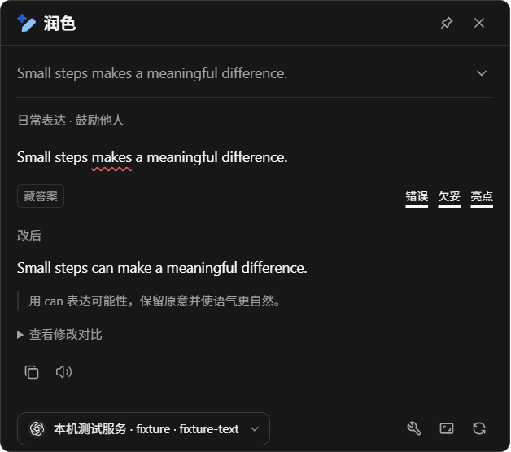

# 交付与验证报告

2026-11-03 · **TextHop 0.10.0**

- 类型检查、76 项单元测试、16 项桌面流程和 4 项旧配置升级检查通过。语音覆盖旧配置升级、按语言和地区选音色、长文本分段、音频响应校验、错误状态和请求大小上限。[核心测试](core-tests.txt) · [桌面回归](context-smoke.json)
- Windows 上发现 6 个本机声音。实际设置窗口分别调用英文 David 和中文 Huihui，系统报告了开始和结束。在线部分使用本机兼容端点返回可解码的音频，验证自定义音色、语速与音高、音量、自动保存、停止请求和跨窗口切换。划词工具栏和译文卡片均使用保存的设置。[语音验收](speech-verification.json) · [打包版语音验收](packaged-speech-verification.json) · [浅色截图](screenshots/v0.10/tts-light.png) · [深色截图](screenshots/v0.10/tts-dark.png)

- 在发布目录的 `TextHop.exe` 中重新验证了 8 项语音流程和标准打包检查，包括本机试听、在线音频解码、译文朗读、跨窗口停止、语音服务连接测试，以及移除自定义音色后恢复兜底。提供商设置的双向分配、模型选择和界面语言切换也通过回归。验收中的在线服务为回环 HTTP 端点。[Windows 打包验证](packaged-smoke.json)

## 0.9.0

本次对照覆盖划词入口、写作分析、笔记库选择与保存，并补充托盘开机自启和缓存时长控件。[逐项对照与截图](READ-FROG-PARITY.md)

- 类型检查与 72 项单元测试通过，覆盖字段类型、稳定 ID、异源连接、旧库恢复、原文与译文分别写入，以及精确定位重复词语的标注。
- 桌面端 16 项流程检查和 4 项升级检查通过。写作分析可在流式生成期间手动收起，旧版默认固定状态和自定义配置继续生效。[桌面验收记录](context-smoke.json) · [写作浮窗](screenshots/v0.9/writing-light.png)
- Windows 打包程序验证了首次登录启动保持后台、从托盘打开设置、用预设替换旧版 17 分钟缓存、内联模型选择、快捷键和随包离线 OCR。托盘开关在真实 Electron 菜单上调用，系统登记读写使用隔离模拟。没有执行物理重启、注销、安装或卸载。[打包验收记录](packaged-smoke.json) · [缓存设置](screenshots/v0.9/cache-settings.png)
- 指令连接已有笔记库时可以选择类型相符的列。书签首次建库、推荐笔记保存和删除指令后回看笔记均有独立端到端覆盖。[指令验收](packaged-action-schema-verification.json) · [推荐笔记验收](packaged-note-suggestion-verification.json)

## 0.8.1 及此前的验证记录

## 本次重做

主窗口改为纯设置；全局选区进入鼠标旁图标工具条与独立动作浮窗。翻译、词典、润色按 Read Frog 的公开组件、截图和图标集重新实现。普通设置、动作、凭据和 WebDAV 连接自动保存；深浅/系统主题同步到各窗口。

0.2.1 补齐无法选择文字时的独立 OCR 入口：无选区引导、框选后自动本地识别、原图校对和相同动作卡片衔接。远程 OCR 保留显式发送，取消框选恢复旧内容和固定状态。修复 Windows 125% 缩放下按屏幕边界换算导致的裁剪偏差，改为使用实际框选视口。

0.2.2 增加翻译/词典/润色及自定义动作的独立快捷键，按组合键录入、自动保存、冲突提示与停用；升级保留 v1 原来的直接翻译键。显式快捷键重新读取选区，忽略旧缓存；OCR / 剪贴板浮窗中使用当前校对文本。设置与录入保护、重复触发抑制和迟到读取隔离已覆盖。

0.3.0 将文字与视觉服务统一为服务提供商，增加六个预设与自定义兼容接口、模型发现和手动填写；WebDAV 与配置迁移合并为配置管理。默认 OCR 使用随包内置资源，移除运行时下载/导入和 Ollama 原生适配。旧配置及对应加密凭据可迁移到 schema v3。

0.4.0 在服务商页增加“模型与用途”：同一账户添加多个模型，直接为模型分配翻译、词典、润色、OCR 或其他动作。15 个内置 ID、接口发现与自定义 ID 合并搜索；动作、OCR 和浮窗共用选择器。各动作独立绑定，浮窗临时切换不改写设置。schema v4 保留旧模型与用途；未临时切换模型的浮窗重试会读取最新配置。

0.5.0 使用单模型提供商。复制会保留绑定到原地址的本机密钥和请求头。动作、OCR 和语言检测共用提供商选择。界面支持系统语言、简体中文与英文，快捷键单独成页。划词工具栏直接展开动作菜单，支持固定、拖动和按时段或应用停用。

0.6.0 将指令改为左侧列表和就地编辑。模型搜索贴着输入框展开。指令编辑器可搜索 11,534 个离线图标。文本和结构化卡片支持流式显示，短期内可复用已完成的相同请求。点击结果书签会保存到独立的本地笔记库。

## 验证证据

- 0.8.1 的 Windows 打包版通过授权的兼容服务调用 `glm-5.3-flash`，推理强度设为 `xhigh`。随机代码和中文只出现在图片像素中，两行均识别准确。交互测试逐条查看了 8 处长难句标注，验证写作隐藏与显示答案、保存两条推荐及一张词典卡、相同词典请求命中缓存。自定义数量卡返回数字 `3` 并在 Liquid 卡片中显示原文。[实测数据](live-model-verification.json) · [长难句浮窗](screenshots/v0.8.1/sentence-analysis.png) · [写作练习](screenshots/v0.8.1/writing-practice.png)

- 0.8.0 对照 Read Frog 1.54.1 的自定义指令编辑器实现了模板、输出 Schema、HTML + Liquid 编辑与预览、本地笔记字段映射。开发版和 Windows 打包版都从空白模板完成了同一条指令。测试覆盖字段排序和重名校验、重命名联动、先显示部分回答、数字字段保留 `0`、类型错误、保存后删除指令仍可查看历史卡片。模型响应由受控回环服务提供。[开发版流程](action-schema-verification.json) · [打包版流程](packaged-action-schema-verification.json) · [输出字段实机图](screenshots/v0.8/command-output-schema.png) · [版式编辑实机图](screenshots/v0.8/command-layout-studio.png)

- 0.7.0 在翻译后推荐可勾选的词条。受控回环服务分别延迟译文与推荐，实测了独立模型分配、勾选保存、原句回看、切换目标语言、取消迟到请求及从卡片关闭推荐。Windows 打包版通过同一组用例。[划词工具栏测试](note-suggestion-verification.json) · [打包版推荐测试](packaged-note-suggestion-verification.json) · [浅色实机图](screenshots/v0.7/suggested-notes-light.png) · [深色实机图](screenshots/v0.7/suggested-notes-dark.png)

- 桌面测试刻意在词典定义输出一半时暂停服务端，确认窗口内已有可读释义。随后验证收藏、搜索、重新生成、清空缓存以及在列表、工具栏、结果窗中显示同一自选图标。[实际窗口测试](context-smoke.json)
- Windows 悬停测试从省略号移入菜单行，验证菜单只挂载一次，工具栏位置与原生窗口尺寸保持一致。[工具栏验证](toolbar-verification.json)

- 配置校验、迁移、并发写入、自动保存、文本与视觉协议、WebDAV、快捷键和多屏工具栏定位均有回归测试。[核心输出](core-tests.txt)
- 设置页在实际 Electron 窗口操作。回环服务记录了翻译、词典、LLM 检测、模型发现和图片请求的模型、请求头及温度。[设置验证](settings-verification.json)
- 划词工具栏验证了鼠标展开、固定、键盘与鼠标排序、保留选区、创建动作、按应用与全局禁用，以及跨重启的一小时暂停。[工具栏验证](toolbar-verification.json)
- 文字浮窗、设置录入、实际系统快捷键注册和内置 OCR 校对流程在隔离配置中运行。选区和按键回调由开发测试入口触发。[桌面流程](context-smoke.json) · [快捷键验证](shortcut-verification.json)
- 在 Windows 125% 缩放的桌面上，实际框选得到的图像与指针选择的像素一致，内置 OCR 成功识别测试样例。取消框选、校对后调用动作、远程识别前预览也已通过。[截图流程验证](input-flow-verification.json)
- 旧配置通过本机操作系统加密的测试凭据与回环端点验证。[升级验证](upgrade-verification.json)

## 交付产物

当前 Windows x64 安装程序 `release/TextHop Setup 0.10.0.exe` 与便携程序 `release/TextHop 0.10.0.exe` 均包含中英文离线 OCR。可直接运行目录位于 `release/win-unpacked`。大小与 SHA-256 见 [发布清单](release-manifest.json)，运行检查见 [打包验证](packaged-smoke.json)。

## 未完成验收

1. **真实 Windows 前台选区**。0.8.1 的 UIA helper 已连接。专用编辑器已选中 33 个字符，等待 60 秒期间前台仍属于其他窗口。Computer Use 激活测试窗口返回 `failed to activate captured window`。第三方应用中的自动划词和原位替换仍需在可交互桌面运行 `npm run test:native` 或使用 [人工清单](PLATFORMS.md)。
2. **安装版 Read Frog 全流程比对**：受保护扩展页面无法读取；本次对照公开源码和官方截图。私有布局引擎未复用，未作像素完全一致的验收结论。
3. **用户 WebDAV** 的同步及冲突处理已使用受控 HTTP 服务验证，用户自己的 NAS 尚待连接验收。
4. **macOS、X11、KDE Wayland、多显示器/混合 DPI、其他系统语音引擎**：有实现或明确回退，仍需目标环境交互验证。CI 配置已写入，但本仓库未提交或触发远程 CI。
5. **正式分发**：签名/公证、安装与卸载、上述 live 集成流程仍未完成。

## 画面

[0.6.0 的模型字段、指令编辑器、图标选择器和本地笔记库实机截图](screenshots/v0.6/)

[0.5.0 的 API 提供商、语言检测、OCR、快捷键与划词工具栏实机截图](screenshots/v0.5/)包含浅色和深色主题。

0.4.0 新增 [模型搜索、用途分配、动作模型与 OCR 选择截图](screenshots/v0.4/)，深浅主题均来自实际运行。模型请求由本机测试服务响应；目录及参考依据见 [模型说明](MODELS.md)。

0.3.0 新增 [服务商目录、配置编辑、离线/服务商 OCR 与配置管理截图](screenshots/v0.3/)，各包含深浅主题。地址、模型和连接结果为本机测试 fixture。

[主题与场景预览](context-preview.html) · [设计对照](DESIGN.md) · [截图目录](screenshots/v0.2/)

新增 [OCR 入口与校对截图](screenshots/v0.2.1/)；图中文字为真实本地识别，远程识别与润色输出为本机 HTTP 测试响应。

0.2.2 新增 [快捷键录入与 OCR 快捷键动作截图](screenshots/v0.2.2/)；深浅两种主题均已检查。

`docs/brand/`、根层旧 screenshots 与 desktop-smoke.json 是 0.1.x 的历史证据，不代表当前布局。
