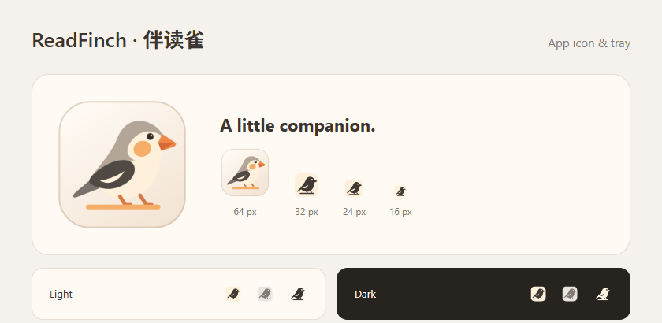

# ReadFinch · 伴读雀

ReadFinch uses a finch resting beside a text-selection line: a companion that appears where the reader is already working.

The identity uses a warm-white ground, a charcoal wing, warm-gray crown and apricot cheek. The bird faces right and stands beside an orange selection underline. It is newly drawn for this identity, with no green in the app icon or banner.

## Identity

- English name: **ReadFinch**; Simplified Chinese name: **伴读雀**.
- Full-color vector: [mark.svg](../../assets/brand/mark.svg).
- Small and monochrome vector: [mark-mono.svg](../../assets/brand/mark-mono.svg).
- The app icon, title-bar mark and tray assets are generated together by `node scripts/icon.mjs`.
- Small icons use a solid background and a simplified silhouette. The eye and wing remain cutouts in both light and dark monochrome versions. macOS template assets retain transparency.

## Banner

[README banner](../assets/readfinch-banner.png), generated with the built-in imagegen tool. The image is stored inside this repository and is not fetched from a private asset host. [Exact generation prompt](BANNER-PROMPT.md).

## Application identity

The product name, executable, installer and startup registration use **ReadFinch**. The package and renderer bridge use `readfinch`; the application ID and Linux desktop identity use `app.readfinch.ReadFinch`. Native selection helpers are named `readfinch-selection`. The application uses its own ReadFinch data directory and encryption identity, with no alternate product-name aliases or automatic import from another application's directory. When relocating a portable executable, toggle launch at login off and on to register its new path.
