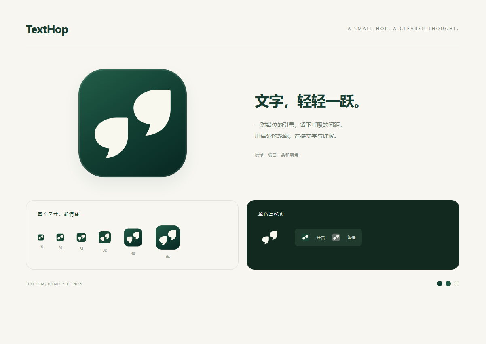
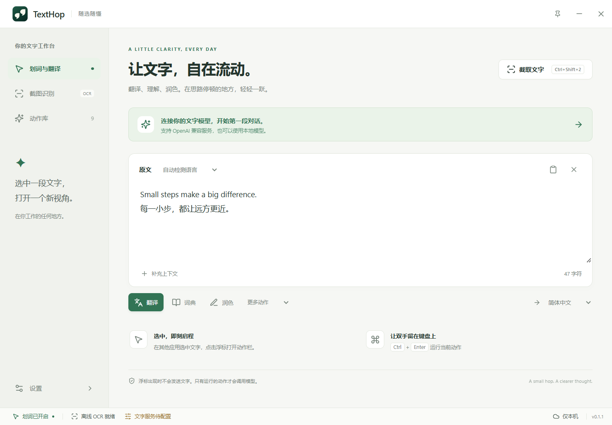
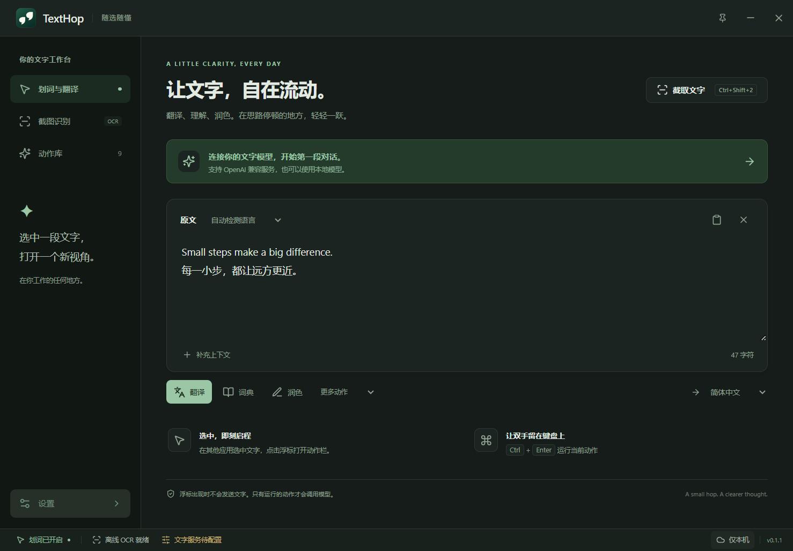

# ReadFinch 品牌

当前品牌与图标见 [ReadFinch · 伴读雀](READFINCH.md)，README banner 见 [图片](../assets/readfinch-banner.png)。下文保留早期 TextHop 设计历史，不代表当前标识。

# TextHop 0.1.1 视觉更新

> 历史记录：0.2.0 已移除本页所示工作台与状态栏，工作界面改为鼠标旁工具条和结果浮窗。当前界面见 [设计说明](../DESIGN.md) 和 [预览](../context-preview.html)。应用与托盘的图标资产仍保留；下文验证仅适用于 0.1.1。

本次采用错位双引号：以文字标点作为识别核心，右侧上移表达一次轻巧的跳跃。深松绿底、暖白形状，留出足够的内部间距；没有保留被否定的 T 与箭头方向。

## 文件与生成

- 矢量母版：`assets/brand/mark.svg`。引号形状由两条闭合贝塞尔路径构成。
- 窗口、浮标：`src/renderer/public/brand/icon.svg`，直接使用同一矢量标识。
- 应用主图：`src/renderer/public/icon.png`，1024 px，透明外角。
- Windows 图标：`src/renderer/public/icon.ico`，内含 16/20/24/32/40/48/64/128/256 px 帧。
- 小尺寸采用纯色底、稍加放大的形状；托盘提供 16–48 px 和独立的暂停灰色版。
- macOS 提供 18 px / 36 px 的透明单色 Template 图标，尚待 macOS 目标机验证。
- `node scripts/icon.mjs` 从母版生成上述资源，使用 resvg 栅格化，所有输出保存在项目内。

探索图使用内置 imagegen 生成，保存在 [exploration.png](exploration.png)；采用其中 01 方向，重新绘制为可维护的矢量图形。完整生成提示词见 [PROMPT.md](PROMPT.md)。没有把探索拼图直接裁切充当应用图标。

## 状态栏与托盘

主窗口和紧凑窗口底部固定显示状态，内容区域独立滚动。状态栏可暂停/恢复自动划词，查看 OCR 与文字服务配置，进入同步设置。运行中显示当前文字/OCR 任务，快捷键异常提供设置入口。

“文字服务已配置”仅表示填写完整，不等同于连接测试通过。划词助手状态通过独立事件更新，不会刷新设置草稿。窄窗口折叠次要文字，保留可读的按钮名称与工具提示。

系统托盘包含打开应用、自动划词开关、截图、读取剪贴板、设置和退出；暂停后图标变为灰色。Windows 安装包、窗口和托盘分别使用适合各自尺寸的同源资产。

## 验证

`npm run typecheck`、`npm run build`、`npm run test:brand`。状态开关持久化、设置标签跳转、窄窗口无横向溢出、图标解码均已验证，详见 [verification.json](verification.json)。系统托盘的实际鼠标交互和 macOS 外观仍需对应桌面环境检查。

构建依据：[resvg-js](https://github.com/thx/resvg-js)、[Electron Tray](https://www.electronjs.org/docs/latest/api/tray)、[nativeImage](https://www.electronjs.org/docs/latest/api/native-image)。
