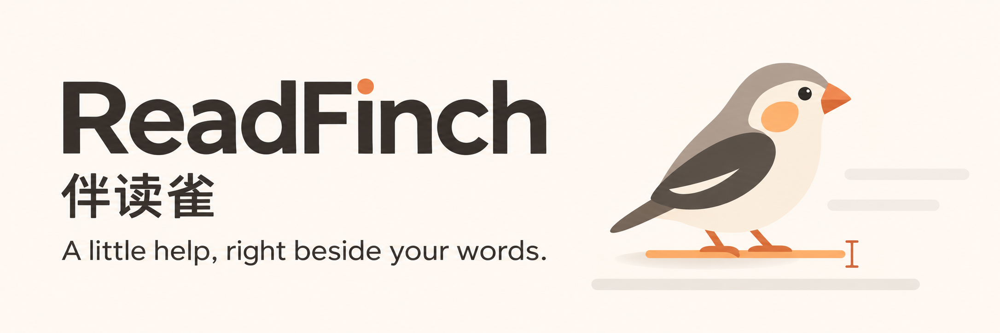
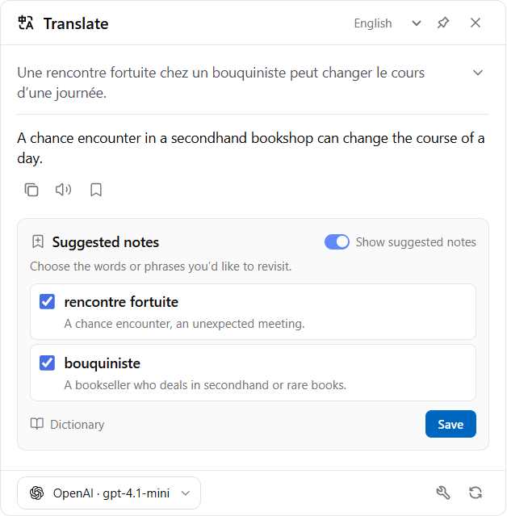
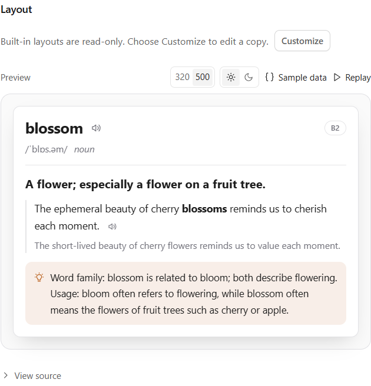
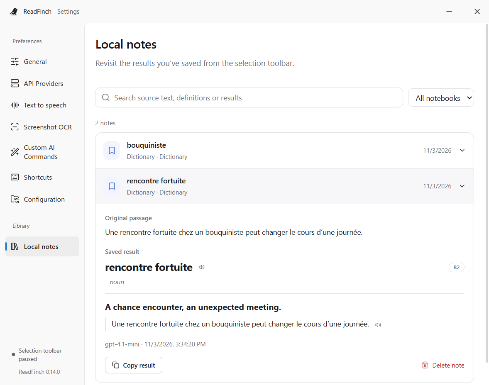

<!-- Generated from docs/readmes/content.json by npm run docs:readme. -->
<div align="center">
<a id="readme-top"></a>



# ReadFinch · 伴读雀

**言葉のすぐそばに、読書のパートナー。**

ReadFinch は、デスクトップでの読書と文章作成を支援するオープンソースアプリです。さまざまなアプリで選択した文章を翻訳し、単語を調べ、文章を推敲し、ノートに保存できます。選択できない画像内の文字は OCR で取り込めます。

<p><a href="../../README.md">English</a> · <a href="../../docs/readmes/README.zh-CN.md">简体中文</a> · <a href="../../docs/readmes/README.zh-TW.md">繁體中文</a> · <strong>日本語</strong> · <a href="../../docs/readmes/README.ko.md">한국어</a> · <a href="../../docs/readmes/README.fr.md">Français</a> · <a href="../../docs/readmes/README.de.md">Deutsch</a> · <a href="../../docs/readmes/README.es.md">Español</a></p>

<p>
<a href="../../LICENSE"></a>


</p>

[最新版をダウンロード](https://github.com/0xlane/ReadFinch/releases/latest) · [使い始める](#get-started) · [機能](#features) · [ドキュメント](#documentation) · [問題を報告](https://github.com/0xlane/ReadFinch/issues)

</div>

## 読む流れを、そのままに

ブラウザー、PDF リーダー、エディターで文字を選択すると、カーソルのそばに小さなツールバーが現れ、原文の近くに結果を表示します。結果を固定して読み比べたり、覚えておきたい単語を保存したりできます。

<p align="center">
<picture>
  <source media="(prefers-color-scheme: dark)" srcset="../../docs/assets/reading-en-dark.png">
  
</picture>
<br><em>選ぶ → 理解する → 残す。知らない言葉を、自分で使える言葉へ。</em>
</p>

<a id="features"></a>

## 主な機能

| やりたいこと | ReadFinch でできること |
| --- | --- |
| **文章を読み解く** | 翻訳をストリーミング表示し、発音・意味・例文を調べ、長い文の構造をわかりやすく分解します。 |
| **表現を整える** | 原文のどこが変わるかを確認し、修正理由と改善後の文章を読み比べて、エディターに戻せます。 |
| **選択できない文字を読む** | 画面の一部をキャプチャするか画像を読み込み、文字を抽出して翻訳・辞書・カスタム指示に利用できます。 |
| **読みながら聴く** | 選択範囲、翻訳、例文をシステムのオフライン音声またはオンライン音声で読み上げます。言語別に音声を選んで試聴でき、再生設定は音声サービスに応じて調整できます。 |
| **自分用の AI 指示を作る** | プロバイダー、プロンプト、アイコン、ショートカット、型付き出力フィールドを設定。HTML + Liquid で結果カードを整え、フィールドをローカルノートに対応付けられます。 |
| **大切な内容を残す** | 結果を保存するか、おすすめの単語を選びます。ローカルノートを検索して、保存時の原文と回答を一緒に振り返れます。 |

<details>
<summary><strong>AI 指示とノートを見てみる</strong></summary>

<p align="center">
<picture>
  <source media="(prefers-color-scheme: dark)" srcset="../../docs/assets/commands-en-dark.png">
  
</picture>
<br><em>構造化された回答を読みやすいカードに。幅やライト・ダークモードを切り替えてレイアウトを確認できます。</em>
</p>

<p align="center">
<picture>
  <source media="(prefers-color-scheme: dark)" srcset="../../docs/assets/notebook-en-dark.png">
  
</picture>
<br><em>読書で見つけた言葉を手元に。検索して、読み返して、学び直せます。</em>
</p>

</details>

### 機能ごとにプロバイダーを選択

自分の API アカウントで OpenAI、Anthropic、Gemini、DeepSeek、Azure、Amazon Bedrock、OpenRouter などに接続できます。Chat Completions・Responses 互換 API や翻訳専用サービスにも対応しています。各 AI プロバイダー項目にはモデルを 1 つ設定し、別のモデルを使う場合は項目を複製します。翻訳、辞書、文章改善、OCR、言語検出、オンライン読み上げにそれぞれプロバイダーを割り当てられます。サービスに応じて、モデル候補、接続テスト、温度、カスタムヘッダー、個別プロキシを設定できます。

### 対応言語

翻訳と解説の出力先として、次の 8 言語を選択できます。

**English · 简体中文 · 繁體中文 · 日本語 · 한국어 · Français · Deutsch · Español**

**アプリの画面表示は英語と簡体字中国語に対応**し、初期設定ではシステム言語に従います。表示言語と出力言語は個別に設定できます。翻訳品質と言語への対応は、選んだプロバイダーとモデルによって異なります。

<a id="get-started"></a>

## 使い始める

**[最新版をダウンロード](https://github.com/0xlane/ReadFinch/releases/latest)**

最新リリースから、お使いの OS に合うパッケージを選んでください。パッケージ版の利用に開発ツールは不要です。

| システム | パッケージ |
| --- | --- |
| Windows x64 | インストール版は `*-setup.exe`、インストール不要のポータブル版は `*-portable.exe`。 |
| macOS | Apple シリコンは `arm64`、Intel は `x64`。`.dmg` と `.zip` を提供しています。 |
| Linux x64 | 直接実行する `.AppImage`、または Debian・Ubuntu 向けの `amd64.deb`。 |

自動更新チェックは初期設定で有効です。「About」で設定変更や手動チェックができます。Windows インストール版と Linux AppImage は、ダウンロードした更新を終了時に適用できます。Windows ポータブル版、macOS、Linux DEB は手動でインストールします。

### 初めて使うとき

1. **プロバイダーを接続する。** API Providers でプリセットまたは互換エンドポイントを選び、必要な認証情報とモデルを入力して接続をテストします。既定のプロバイダー、または特定機能のプロバイダーに設定できます。
2. **一文を選択する。** ツールバーの Translate を押して翻訳先の言語を選びます。読み比べたいときは、ピンで結果を固定できます。
3. **画像から文字を取得する。** 下記の OCR ショートカットで範囲を選び、認識結果を確認してから指示を選択します。

### 便利なショートカット

| 操作 | Windows / Linux | macOS |
| --- | --- | --- |
| 選択範囲を翻訳 | `Alt + T` | `Option + T` |
| 辞書を開く | `Alt + Shift + D` | `Option + Shift + D` |
| 文章を改善 | `Alt + Shift + W` | `Option + Shift + W` |
| 指示を選ぶ | `Ctrl + Shift + Space` | `Command + Shift + Space` |
| 画面の文字を OCR で取得 | `Ctrl + Shift + 2` | `Command + Shift + 2` |
| クリップボードの文字を読む | `Ctrl + Shift + V` | `Command + Shift + V` |

ショートカットは専用設定ページで変更できます。設定は自動保存され、外観はシステム連動またはライト・ダークから選べます。ログイン時の自動起動は初期状態ではオフで、トレイメニューから変更できます。

### プラットフォーム対応

| プラットフォーム | 文字の取得方法 |
| --- | --- |
| Windows | UI Automation および Java Access Bridge を通じて、前面のアプリの選択テキストを読み取ります。 |
| macOS | 選択テキストにはアクセシビリティ、画面キャプチャには画面収録の許可が必要です。 |
| Linux | X11 は PRIMARY 選択を利用します（`xclip`、`xdotool`、`xprop` が必要）。Wayland はクリップボードまたはデスクトップのスクリーンショットポータルを使用し、ショートカットは環境に依存します。 |

自動的に選択範囲を取得するには、使用中のアプリが文字情報を公開している必要があります。取得できない場合は OCR やクリップボードを使えます。権限、各 OS の制限、検証状況は次の資料をご覧ください： [プラットフォーム対応表](../../docs/PLATFORMS.md)。

## データとプライバシー

**端末内のデータ処理。** ノートの内容は端末に保存されます。内蔵 OCR は画像をローカルで処理し、システムのオフライン音声にオンラインサービスは不要です。

**選択したプロバイダーへの送信。** 翻訳や AI 指示では処理に必要な文章を、オンライン読み上げでは読み上げる文章を送信します。オンライン OCR は選択した画面領域または読み込んだ画像を画像対応プロバイダーに送信します。アカウント、サービスの提供状況、利用料金は各プロバイダーが管理します。

**設定は持ち運べます。** ファイルのインポート・エクスポートと手動 WebDAV 同期に対応。プロバイダー設定、指示、ショートカット、ノートのフィールド対応を移行できます。API キーとカスタムヘッダーは端末ごとに設定し直します。ノート本文は設定同期に含まれません。

<a id="documentation"></a>

## ドキュメント

- [アーキテクチャとソース構成](../../docs/ARCHITECTURE.md)
- [プロバイダー・モデル・機能の割り当て](../../docs/MODELS.md)
- [スクリーンショットと画像の文字認識（OCR）](../../docs/OCR.md)
- [設定管理と WebDAV](../../docs/CONFIGURATION.md)
- [プラットフォームと権限](../../docs/PLATFORMS.md)
- [表示言語と翻訳言語](../../docs/LANGUAGES.md)
- [リリースとアプリの更新](../../docs/UPDATES.md)

技術文書は中国語または英語で提供しています。

## 開発への参加

再現できる不具合報告、操作性の改善案、翻訳の修正、プルリクエストを歓迎します。OS とアプリのバージョンを添え、認証情報や私的な文章は例から取り除いてください。 [問題を報告](https://github.com/0xlane/ReadFinch/issues) · [コードを寄稿](https://github.com/0xlane/ReadFinch/pulls).

### ソースからビルド

ローカルでのビルドには **Node.js 24**、npm、Git が必要です。Windows では .NET Framework 4.8 の C# コンパイラーを用意し、`JAVA_HOME` に x64 版 OpenJDK（Temurin 21 など）のパスを設定してください。macOS では Xcode Command Line Tools が必要です。

```sh
git clone https://github.com/0xlane/ReadFinch.git
cd ReadFinch
npm ci
npm run assets:ocr
npm run build
npm start
```

`assets:ocr` は**開発時のビルド準備**として認識データをダウンロードします。データはアプリに同梱されるため、インストール後の言語パック取得は不要です。対象 OS 上で `npm run dist` を実行すると、`release/` にパッケージを生成します。

```sh
npm run typecheck
npm test
npm run build
```

README の文面は `docs/readmes/content.json` で管理しています。翻訳を編集したら `npm run docs:readme` を実行してください。アプリの出力先言語一覧と翻訳の対応範囲をチェックします。

## ライセンスと謝辞

ReadFinch は **GPL-3.0-only** ライセンスで提供しています。選択ツールバーと指示カードの操作設計は **Read Frog** に着想を得ています。独立したデスクトッププロジェクトであり、Read Frog の公式リリースではありません。

[GPL-3.0-only](../../LICENSE) · [Read Frog](https://github.com/mengxi-ream/read-frog) · [サードパーティーの表記](../../THIRD_PARTY_NOTICES.md)

<div align="right">

[↑ 先頭へ](#readme-top)

</div>
