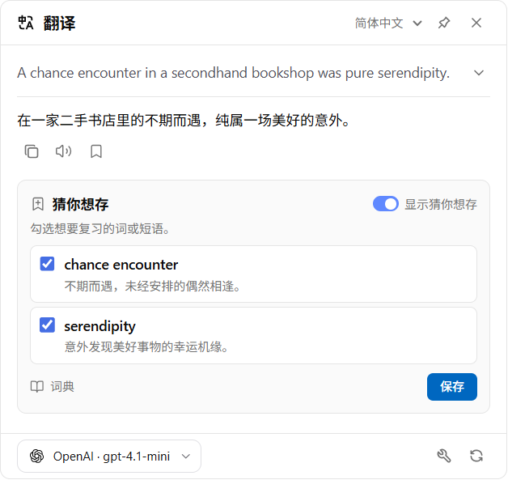
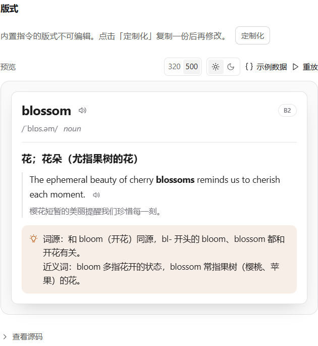
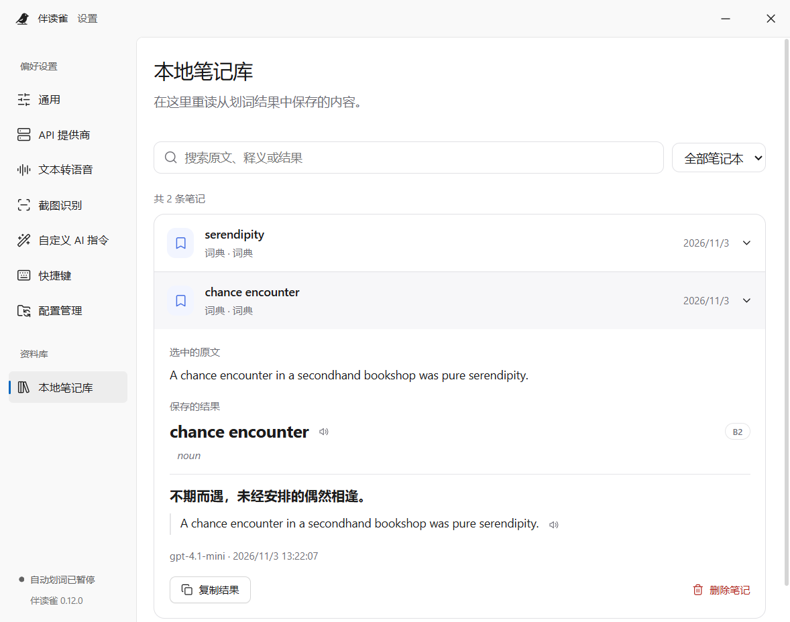

<!-- Generated from docs/readmes/content.json by npm run docs:readme. -->
<div align="center">
<a id="readme-top"></a>


# ReadFinch · 伴读雀

**就在文字旁边，陪你读懂每一句。**

翻译一段文字、读懂一个长句、改好一句表达——留在正在使用的应用里，就能完成。

A desktop reading and writing companion. · 随选随用的桌面阅读与写作助手。

<p><a href="../../README.md">English</a> · <strong>简体中文</strong> · <a href="../../docs/readmes/README.zh-TW.md">繁體中文</a> · <a href="../../docs/readmes/README.ja.md">日本語</a> · <a href="../../docs/readmes/README.ko.md">한국어</a> · <a href="../../docs/readmes/README.fr.md">Français</a> · <a href="../../docs/readmes/README.de.md">Deutsch</a> · <a href="../../docs/readmes/README.es.md">Español</a></p>

<p>
<a href="../../LICENSE"></a>


</p>

[开始使用](#get-started) · [功能介绍](#features) · [技术文档](#documentation) · [反馈问题](https://github.com/0xlane/ReadFinch/issues)

</div>

## 继续阅读，不必来回切换

在浏览器、PDF 阅读器或编辑器里选中文字，伴读雀就会在鼠标旁提供工具栏，并在原文附近展示答案。可以固定结果对照阅读，也可以把值得记住的词留下来。

<p align="center">
<picture>
  <source media="(prefers-color-scheme: dark)" srcset="../../docs/assets/reading-zh-CN-dark.png">
  
</picture>
<br><em>选中 → 理解 → 收藏。从陌生的文字，到可以用起来的知识。</em>
</p>

<a id="features"></a>

## 文字在哪里，帮助就在哪里

| 想做什么 | 伴读雀如何帮你 |
| --- | --- |
| **读懂原文** | 流式查看译文，查询读音、释义和例句，把长难句拆成容易理解的结构。 |
| **改善表达** | 在原句中查看修改位置，对照修改理由与修订稿，再把改好的文字带回编辑器。 |
| **识别无法选中的文字** | 框选屏幕或导入图片，用内置 OCR 离线识别简体中文和英文。核对文字后，再运行指令。 |
| **边读边听** | 朗读选区、译文与例句。按语言选择系统离线音色或兼容的在线音色，并调整语速、音高和音量。 |
| **定制自己的 AI 指令** | 设置提供商、提示词、图标、快捷键和输出字段，以 HTML + Liquid 编排结果卡片，并将字段映射到本地笔记库。 |
| **留下值得记住的内容** | 收藏结果，或勾选「猜你想存」推荐的词条。通过本地搜索回看保存时的原文与答案。 |

<details>
<summary><strong>看看指令与笔记库</strong></summary>

<p align="center">
<picture>
  <source media="(prefers-color-scheme: dark)" srcset="../../docs/assets/commands-zh-CN-dark.png">
  
</picture>
<br><em>把结构化回答排成易读的卡片，随时检查不同宽度和深浅色下的效果。</em>
</p>

<p align="center">
<picture>
  <source media="(prefers-color-scheme: dark)" srcset="../../docs/assets/notebook-zh-CN-dark.png">
  
</picture>
<br><em>把阅读中的发现留在身边，随时搜索、回看和复习。</em>
</p>

</details>

### 用自己的提供商，选适合的模型

支持 33 种提供商选项，涵盖 OpenAI、Anthropic、Gemini、DeepSeek、Azure、Amazon Bedrock、OpenRouter 与纯翻译服务，支持原生 API、Chat Completions 和 Responses。一个 AI 提供商条目对应一个模型，可复制条目使用其他模型。翻译、词典、写作、OCR 和语言检测可分别分配提供商，并支持模型联想、连接测试、温度、自定义请求头及独立代理。

### 用熟悉的语言阅读

README 与应用预置的 8 种目标语言保持一致：

**English · 简体中文 · 繁體中文 · 日本語 · 한국어 · Français · Deutsch · Español**

**应用界面目前支持简体中文和英文**，默认跟随系统。翻译质量及其他语言能力取决于所选模型；内置离线 OCR 支持简体中文和英文。

<a id="get-started"></a>

## 开始使用

本地构建需要 **Node.js 24**、npm 和 Git。Windows 需要 .NET Framework 4.8 的 C# 编译器；macOS 需要 Xcode 命令行工具。

```sh
git clone https://github.com/0xlane/ReadFinch.git
cd ReadFinch
npm ci
npm run assets:ocr
npm run build
npm start
```

`assets:ocr` 仅在**开发构建阶段**准备识别数据。数据随应用打包，安装后无需下载语言包。在目标操作系统上运行 `npm run dist`，安装包会生成到 `release/`。

### 第一次使用

1. **接入提供商。** 打开「API 提供商」，选择预设或兼容接口，填写所需凭据与模型并测试连接。可设为默认提供商，也可单独分配给某项功能。
2. **选中一句话。** 点击划词工具栏的「翻译」，选择目标语言。需要对照时，点图钉固定结果即可。
3. **试试截图取词。** 使用下方 OCR 快捷键，框选区域并核对识别文字。内置 OCR 和系统朗读无需先配置 AI 提供商。

### 常用快捷键

| 指令 | Windows / Linux | macOS |
| --- | --- | --- |
| 翻译选区 | `Alt + T` | `Option + T` |
| 打开词典 | `Alt + Shift + D` | `Option + Shift + D` |
| 写作改进 | `Alt + Shift + W` | `Option + Shift + W` |
| 选择指令 | `Ctrl + Shift + Space` | `Command + Shift + Space` |
| 框选屏幕文字 | `Ctrl + Shift + 2` | `Command + Shift + 2` |
| 读取剪贴板 | `Ctrl + Shift + V` | `Command + Shift + V` |

快捷键可在独立设置页面重新绑定。设置自动保存，外观可跟随系统或手动切换深浅色。开机自启默认关闭，可在托盘菜单中切换。

### 融入桌面使用习惯

| 平台 | 如何取得文字 |
| --- | --- |
| Windows | 通过 UI Automation 读取前台应用提供的文本选区。 |
| macOS | 读取选区需要辅助功能授权；截图需要屏幕录制权限。 |
| Linux | X11 使用 PRIMARY 选区，依赖 `xclip`、`xdotool`、`xprop`。Wayland 使用剪贴板或桌面截图门户，快捷键能力取决于桌面环境。 |

Windows 已在开发机器上验证。macOS 和 Linux 提供对应实现，原生桌面交互仍需在目标系统验收，详见 [平台支持矩阵](../../docs/PLATFORMS.md).

## 文字与数据，去向清楚

**笔记和离线能力留在本机。** 笔记正文保存在设备上的 SQLite 数据库中；离线 OCR 和系统音色在本地运行。本地笔记库页面只显示本地内容。

**AI 请求交给你选择的提供商。** 翻译和自定义指令发送所需文字，在线朗读发送待朗读内容。远程图片识别会先展示原图与目标提供商，由你明确开始请求。

**配置可以迁移。** 支持文件导入、导出和手动 WebDAV 同步，迁移提供商设置、指令、快捷键与笔记字段映射。API Key 和自定义请求头按设备保存，新设备需要单独配置；笔记正文不包含在配置同步中。

<a id="documentation"></a>

## 进一步了解

- [应用架构与源码目录](../../docs/ARCHITECTURE.md)
- [提供商、模型与功能分配](../../docs/MODELS.md)
- [离线 OCR 与视觉接口](../../docs/OCR.md)
- [配置管理与 WebDAV](../../docs/CONFIGURATION.md)
- [平台支持与权限](../../docs/PLATFORMS.md)
- [界面、翻译与解释语言](../../docs/LANGUAGES.md)

技术文档使用中文或英文。

## 一起让伴读雀更好用

欢迎提交可复现的问题、交互建议、翻译修订和代码贡献。反馈时请注明操作系统与应用版本，并移除示例中的凭据和私人文字。 [反馈问题](https://github.com/0xlane/ReadFinch/issues) · [贡献代码](https://github.com/0xlane/ReadFinch/pulls).

```sh
npm run typecheck
npm test
npm run build
```

README 文案维护在 `docs/readmes/content.json`。修改翻译后运行 `npm run docs:readme`，生成器会检查是否覆盖应用目标语言列表。

## 许可与致谢

伴读雀采用 **GPL-3.0-only** 许可证。划词工具栏和指令卡片的交互设计受到 **陪读蛙（Read Frog）** 启发。伴读雀是独立桌面项目，并非陪读蛙官方发行版。

[GPL-3.0-only](../../LICENSE) · [Read Frog](https://github.com/mengxi-ream/read-frog) · [第三方组件与资源声明](../../THIRD_PARTY_NOTICES.md).

<div align="right">

[↑ 返回顶部](#readme-top)

</div>
