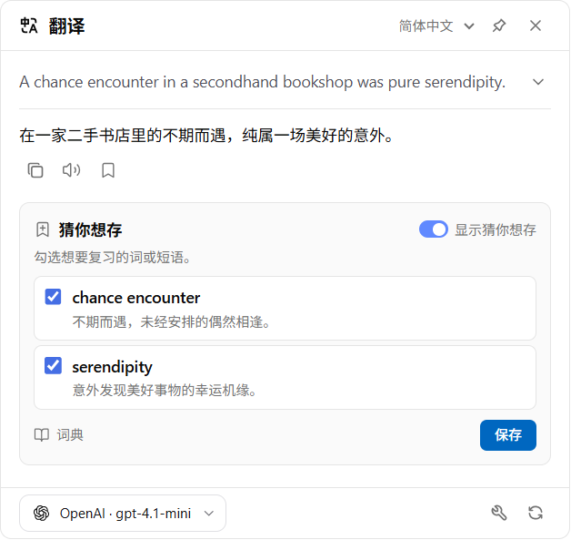
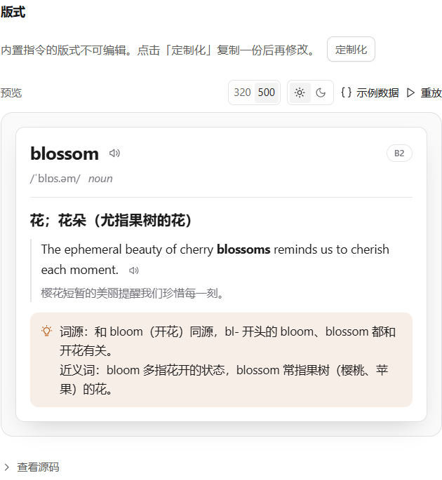
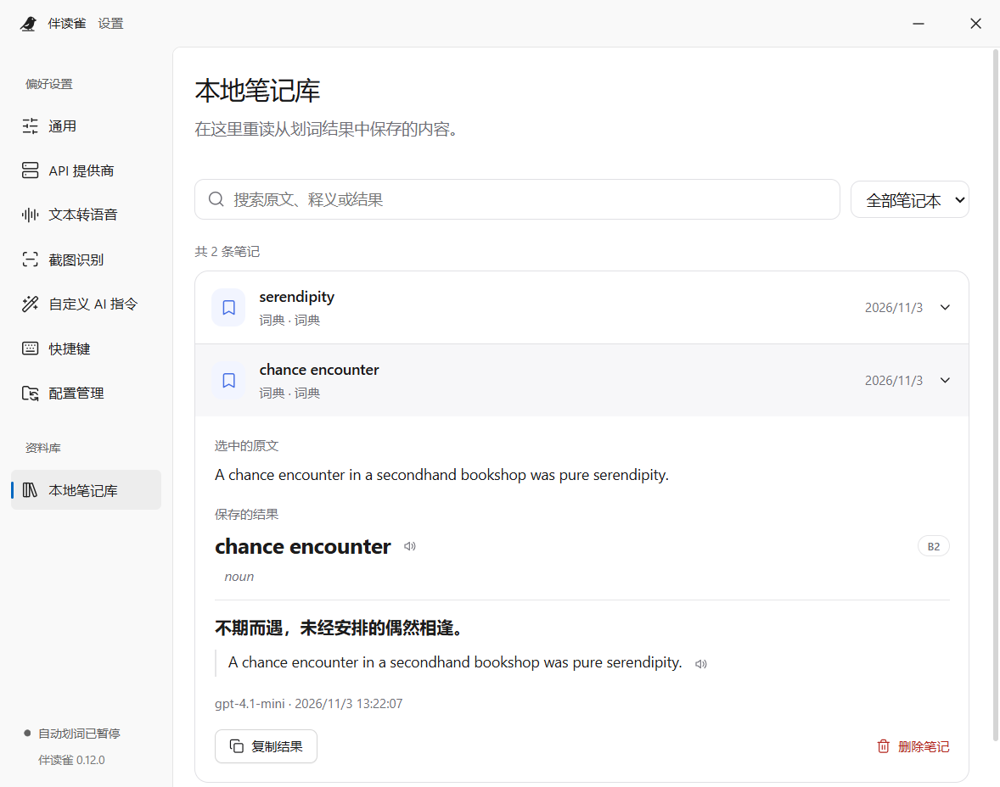

<!-- Generated from docs/readmes/content.json by npm run docs:readme. -->
<div align="center">
<a id="readme-top"></a>


# ReadFinch · 伴读雀

**就在文字旁邊，陪你讀懂每一句。**

伴讀雀是一款開源的桌面閱讀與寫作助手，支援跨應用程式選詞翻譯、查詞、寫作改善、朗讀與本機筆記，也能從截圖和圖片中擷取文字。

<p><a href="../../README.md">English</a> · <a href="../../docs/readmes/README.zh-CN.md">简体中文</a> · <strong>繁體中文</strong> · <a href="../../docs/readmes/README.ja.md">日本語</a> · <a href="../../docs/readmes/README.ko.md">한국어</a> · <a href="../../docs/readmes/README.fr.md">Français</a> · <a href="../../docs/readmes/README.de.md">Deutsch</a> · <a href="../../docs/readmes/README.es.md">Español</a></p>

<p>
<a href="../../LICENSE"></a>


</p>

[下載最新版](https://github.com/0xlane/ReadFinch/releases/latest) · [開始使用](#get-started) · [功能介紹](#features) · [技術文件](#documentation) · [回報問題](https://github.com/0xlane/ReadFinch/issues)

</div>

## 繼續閱讀，不必來回切換

在瀏覽器、PDF 閱讀器或編輯器裡選取文字，伴讀雀就會在游標旁提供工具列，並在原文附近顯示答案。可以釘選結果對照閱讀，也可以留下值得記住的詞彙。

<p align="center">
<picture>
  <source media="(prefers-color-scheme: dark)" srcset="../../docs/assets/reading-zh-CN-dark.png">
  
</picture>
<br><em>選取 → 理解 → 收藏。讓陌生的文字，成為能夠運用的知識。</em>
</p>

<a id="features"></a>

## 主要功能

| 想做什麼 | 伴讀雀如何協助 |
| --- | --- |
| **讀懂原文** | 即時查看逐步產生的譯文，查詢發音、釋義和例句，將長句拆解成容易理解的結構。 |
| **改善表達** | 在原句中查看修改位置，對照修改理由與修訂稿，再將改好的文字帶回編輯器。 |
| **辨識無法選取的文字** | 框選螢幕或匯入圖片，擷取其中的文字，繼續翻譯、查詞或執行自訂指令。 |
| **邊讀邊聽** | 透過系統離線語音或線上語音朗讀選取內容、譯文與例句，可依語言選擇聲音並試聽；可調整的播放設定取決於語音服務。 |
| **自訂 AI 指令** | 設定供應商、提示詞、圖示、快捷鍵及輸出欄位，以 HTML + Liquid 編排結果卡片，並將欄位對應至本機筆記庫。 |
| **留下值得記住的內容** | 收藏結果，或勾選建議儲存的詞彙。透過本機搜尋，回看儲存當時的原文與答案。 |

<details>
<summary><strong>看看指令與筆記庫</strong></summary>

<p align="center">
<picture>
  <source media="(prefers-color-scheme: dark)" srcset="../../docs/assets/commands-zh-CN-dark.png">
  
</picture>
<br><em>將結構化回答排成易讀的卡片，隨時檢查不同寬度及淺色、深色模式的效果。</em>
</p>

<p align="center">
<picture>
  <source media="(prefers-color-scheme: dark)" srcset="../../docs/assets/notebook-zh-CN-dark.png">
  
</picture>
<br><em>讓閱讀中的發現留在身邊，隨時搜尋、回顧和複習。</em>
</p>

</details>

### 為不同功能選擇供應商

使用自己的 API 帳戶，連接 OpenAI、Anthropic、Gemini、DeepSeek、Azure、Amazon Bedrock、OpenRouter 等預設供應商，或新增相容 Chat Completions、Responses 的自訂介面，也支援專用翻譯服務。每個 AI 供應商項目使用一個模型，複製項目即可設定其他模型。翻譯、詞典、寫作、OCR、語言偵測及線上朗讀可分別選擇供應商；模型建議、連線測試、溫度、自訂請求標頭及獨立代理依服務能力提供。

### 語言支援

翻譯與解釋可選擇以下 8 種預設目標語言：

**English · 简体中文 · 繁體中文 · 日本語 · 한국어 · Français · Deutsch · Español**

**應用程式介面支援簡體中文與英文**，預設跟隨系統。介面語言與輸出語言分開設定；翻譯品質及支援的語言範圍取決於所選供應商與模型。

<a id="get-started"></a>

## 開始使用

**[下載最新版](https://github.com/0xlane/ReadFinch/releases/latest)**

在最新發行版本中選擇適合目前系統的安裝套件，使用已封裝的應用程式不需要安裝開發工具。

| 系統 | 安裝套件 |
| --- | --- |
| Windows x64 | `*-setup.exe` 為安裝版，`*-portable.exe` 為免安裝可攜版。 |
| macOS | Apple 晶片選擇 `arm64`，Intel 選擇 `x64`，提供 `.dmg` 與 `.zip`。 |
| Linux x64 | `.AppImage` 可直接執行，`amd64.deb` 適用於 Debian、Ubuntu。 |

預設開啟自動檢查更新，可在「關於」頁調整或手動檢查。Windows 安裝版與 Linux AppImage 可在結束應用程式時安裝已下載的更新；macOS 安裝目錄可寫入時支援重新啟動並更新。Windows 可攜版、從唯讀位置執行的 macOS 應用程式與 Linux DEB 需要手動安裝。舊版 macOS 用戶端需先手動升級一次至包含更新助手的版本。

### 第一次使用

1. **連接供應商。** 開啟 API Providers，選擇預設或相容介面，填入所需憑證與模型並測試連線。可以設為預設供應商，也可指派給特定功能。
2. **選取一句話。** 點選工具列上的 Translate，選擇目標語言。需要對照時，點圖釘保留結果即可。
3. **從圖片取詞。** 使用下方 OCR 快捷鍵框選區域，核對辨識出的文字後，選擇需要的指令。

### 常用快捷鍵

| 指令 | Windows / Linux | macOS |
| --- | --- | --- |
| 翻譯選取文字 | `Alt + T` | `Option + D` |
| 開啟字典 | `Alt + Shift + D` | `Option + Shift + D` |
| 改善寫作 | `Alt + Shift + W` | `Option + Shift + W` |
| 選擇指令 | `Ctrl + Shift + Space` | `Command + Shift + Space` |
| 框選螢幕文字 | `Ctrl + Shift + 2` | `Option + Shift + S` |
| 讀取剪貼簿 | `Ctrl + Shift + V` | `Command + Shift + V` |
| 輸入翻譯 | `Alt + A` | `Option + A` |

快捷鍵可在獨立設定頁面重新指定。設定自動儲存，外觀可跟隨系統或手動切換明暗模式。開機自動啟動預設關閉，可在系統匣選單中切換。

### 平台支援

| 平台 | 如何取得文字 |
| --- | --- |
| Windows | 透過 UI Automation 和 Java Access Bridge 讀取前景應用程式的文字選取範圍。 |
| macOS | 讀取選取文字需要輔助使用授權；截圖需要螢幕錄製權限。 |
| Linux | X11 使用 PRIMARY 選取範圍，依賴 `xclip`、`xdotool`、`xprop`。Wayland 使用剪貼簿或桌面截圖入口，快捷鍵能力取決於桌面環境。 |

自動取詞需要目前的應用程式提供可讀取的文字選取範圍。無法直接取詞時，可使用 OCR 或剪貼簿。系統權限、平台限制及驗證情況請參閱 [平台支援矩陣](../../docs/PLATFORMS.md)。

## 資料與隱私

**本機資料處理。** 筆記內容儲存在目前裝置；內建 OCR 在本機處理圖片，系統離線語音不需要線上朗讀服務。

**請求傳送至你選擇的供應商。** 翻譯與 AI 指令傳送請求所需的文字，線上朗讀傳送待朗讀內容；線上 OCR 將框選區域或匯入的圖片傳送給所選視覺供應商。服務帳戶、可用性及使用費用由各供應商管理。

**設定可以移轉。** 支援檔案匯入、匯出及手動 WebDAV 同步，移轉供應商設定、指令、快捷鍵與筆記欄位對應。API Key 和自訂請求標頭依裝置儲存，新裝置須另行設定；筆記內容不包含在設定同步中。

<a id="documentation"></a>

## 文件

- [應用程式架構與原始碼目錄](../../docs/ARCHITECTURE.md)
- [供應商、模型與功能指派](../../docs/MODELS.md)
- [截圖與圖片辨識（OCR）](../../docs/OCR.md)
- [設定管理與 WebDAV](../../docs/CONFIGURATION.md)
- [平台支援與權限](../../docs/PLATFORMS.md)
- [介面語言與翻譯語言](../../docs/LANGUAGES.md)
- [版本發行與應用程式更新](../../docs/UPDATES.md)

技術文件使用中文或英文。

## 參與貢獻

歡迎提出可重現的問題、互動建議、翻譯修訂和程式碼貢獻。回報時請註明作業系統與應用程式版本，並移除範例中的憑證和私人文字。 [回報問題](https://github.com/0xlane/ReadFinch/issues) · [貢獻程式碼](https://github.com/0xlane/ReadFinch/pulls).

### 從原始碼建置

本機建置需要 **Node.js 24**、npm 和 Git。Windows 需要 .NET Framework 4.8 的 C# 編譯器，並將 `JAVA_HOME` 指向 x64 OpenJDK（例如 Temurin 21）。macOS 需要 Xcode 命令列工具。

```sh
git clone https://github.com/0xlane/ReadFinch.git
cd ReadFinch
npm ci
npm run assets:ocr
npm run build
npm start
```

`assets:ocr` 僅在**開發建置階段**準備辨識資料。資料隨應用程式打包，安裝後無須下載語言套件。在目標作業系統上執行 `npm run dist`，安裝套件會產生於 `release/`。

```sh
npm run typecheck
npm test
npm run build
```

README 文案維護於 `docs/readmes/content.json`。修改翻譯後執行 `npm run docs:readme`，產生器會檢查是否涵蓋應用程式的目標語言清單。

## 授權與致謝

伴讀雀採用 **GPL-3.0-only** 授權。文字選取工具列和指令卡片的互動設計受到 **陪讀蛙（Read Frog）** 啟發。伴讀雀是獨立桌面專案，並非陪讀蛙官方發行版。

[GPL-3.0-only](../../LICENSE) · [Read Frog](https://github.com/mengxi-ream/read-frog) · [第三方元件與資源聲明](../../THIRD_PARTY_NOTICES.md)

<div align="right">

[↑ 回到頂端](#readme-top)

</div>
